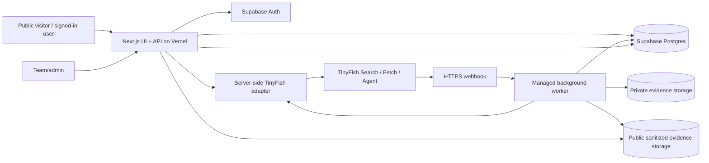

# Nyaya — Architecture

**Status:** Proposed MVP architecture; provider-specific operational details remain subject to verification.

## 1. System overview

## 2. Proposed stack

- Web application: Next.js, React, TypeScript.
- Hosting: Vercel for UI and short-lived API requests.
- Identity and data: Supabase Auth and Postgres.
- Evidence: Supabase Storage or equivalent object storage with separate private and public-sanitized areas.
- Browser automation: TinyFish through a server-side adapter.
- Background work: a small managed worker with HTTPS webhooks, persistent jobs, secret management, and a verified affordable/free-tier plan. Railway is the first candidate, not yet a locked provider; confirm outbound connectivity to TinyFish, persistent-job behavior, and cost limits before committing.

Long-running automation must not run inside a normal user-facing request. API requests create/persist jobs and return identifiers; a worker handles reconciliation and post-processing.

## 3. Trust boundaries

1. Browser/client — untrusted; never trust client-supplied owner IDs, roles, scores, state transitions, or publication decisions.
2. Next.js API — authentication, authorization, validation, idempotency, and orchestration boundary.
3. Supabase — database, auth, and object storage; RLS is defense in depth, not a replacement for server authorization.
4. Worker — trusted service identity with least privilege; secrets injected from platform secret manager.
5. TinyFish — external automation provider; treat webhooks and provider-returned content as untrusted until verified/reconciled.
6. Public evidence — separate sanitized artifacts only; never expose raw private screenshots or case artifacts.

## 4. Core components

### Web application/API
- Public Index pages and published evidence.
- Passwordless sign-in and session handling.
- Case intake, draft review, case tracker, and reminder management.
- Authenticated audit-request intake/tracking.
- Team/admin queue and approval UI.
- Versioned JSON API under `/api/v1`.

### TinyFish adapter
Expose a stable internal interface:
- `startRun(...)`
- `getRun(providerRunId)`
- `cancelRun(providerRunId)`
- `getStepScreenshot(providerRunId, stepId)`
- `normalizeRun(providerPayload)`

Provider-specific statuses and payloads must not leak into domain logic. Map provider states into a stable internal job model. Keep API keys server-side and redact provider errors.

### Background worker
Responsibilities:
- Receive webhook events and persist/deduplicate them.
- Verify provider status by API before trusting completion.
- Reconcile runs when webhooks are missed.
- Fetch eligible screenshots/step artifacts.
- Sanitize and validate evidence.
- Calculate scores using a versioned rubric.
- Publish eligible evidence and scores only after explicit validation.
- Process deletion retries and invalidate public cached artifacts on retraction.

The worker is idempotent, bounded in retries, and uses the database as the source of truth.

## 5. Async job model

Internal job statuses:
`queued → running → succeeded | partial | blocked | failed | timed_out | cancelled`.

- Persist the internal job before calling TinyFish.
- Store provider run ID separately.
- Treat webhooks as best-effort notifications, not sole truth.
- Deduplicate webhook deliveries by stable event/run identifiers where available.
- Reconcile with provider status on webhook and on scheduled/recovery checks.
- Apply bounded retries with backoff only for retryable failures.
- Never retry indefinitely or trigger paid runs implicitly.
- Cancellation is best effort; persist requested and confirmed cancellation separately if needed.
- Do not expose raw provider payloads or screenshots publicly by default.

## 6. Publication pipeline

Publication state:
`not_eligible → pending_validation → published | withheld`.

A run being completed does not mean it is publishable. Publication requires:
1. Run status verified as completed.
2. Evidence mapped to explicit rubric criteria.
3. Sensitive information and personal data removed.
4. Sanitization/validation passed.
5. Score calculation completed with methodology version.
6. Authorized publication action or clearly defined approved publication policy.

Partial, blocked, failed, or timed-out runs remain unpublished. If sanitization fails, withhold the evidence. If evidence is insufficient, do not fabricate dimension scores or an overall score.

Private raw artifacts and public sanitized artifacts must use separate storage paths/buckets and access policies.

## 7. Data entities

- `Service`: canonical service record, category, official route metadata, enabled state.
- `AuditRequest`: authenticated requester, requested service/scope, review status, decision/reason, timestamps.
- `AuditRun`: execution status, provider/run IDs, rubric version, audit timestamps, outcome.
- `AuditEvidence`: criterion mapping, storage reference, sensitivity/sanitization state, public eligibility, provenance.
- `ScoreResult`: dimension scores or unavailable reasons, overall score when valid, confidence, methodology version.
- `TeamMembership`: user/team role; provisioned administratively.
- `Case`: owner, service/demo destination, rights goal, status, timestamps, deletion status.
- `RequestDraft`: versioned draft text and structured scope; private.
- `Job`: internal queue/reconciliation state and idempotency key.
- `CaseEvent`: minimal case lifecycle history; do not store secrets or unnecessary sensitive content.
- `Reminder`: owner/case, due date, timezone semantics, completion state.

Use foreign keys, explicit ownership, indexes for common owner/status/time queries, and constraints for valid enums and uniqueness. Exact SQL schema is an implementation task after state transitions and contracts are locked.

## 8. Storage and deletion

- Keep private case artifacts separate from public sanitized evidence.
- Store object keys/references in Postgres; do not assume deleting a row deletes the object.
- Deletion workflow: mark deletion requested, block new writes, enumerate and delete associated objects via Storage API, delete private DB content in a safe order, verify completion, and record a minimal non-content outcome.
- Make deletion idempotent and retryable. Do not show a success state until all required private artifacts are confirmed deleted.
- Retraction removes public artifacts and sensitive details. Keep only non-sensitive history, methodology version, and reason. Recompute/withdraw scores no longer supported by remaining evidence.
- Define and test cache/CDN invalidation best-effort behavior.

## 9. API outline

All endpoints are under `/api/v1`, JSON, validated, authenticated as needed, and return a consistent error envelope.

### Public
- `GET /services`
- `GET /services/:serviceId`
- `GET /services/:serviceId/audits` — published only
- `GET /audits/:auditId` — public report only when published; operational detail only for authorized team/admin
- `GET /audits/:auditId/evidence` — sanitized public evidence only
- `GET /index/methodology`

### Authenticated user
- `POST /audit-requests`
- `GET /audit-requests`
- `GET /audit-requests/:requestId` — owner-scoped
- `POST /cases`
- `GET /cases`
- `GET /cases/:caseId` — owner-scoped
- `POST /cases/:caseId/discovery-jobs`
- `POST /cases/:caseId/preparation-jobs`
- `GET /jobs/:jobId` — authorized owner/team scope
- `GET /cases/:caseId/evidence`
- `PATCH /cases/:caseId/draft`
- `POST /cases/:caseId/submission-report`
- `POST /cases/:caseId/close`
- `DELETE /cases/:caseId`
- `POST /cases/:caseId/reminders`
- `PATCH /cases/:caseId/reminders/:reminderId`

### Team/admin
- `GET /admin/audit-requests`
- `POST /audit-requests/:requestId/approve`
- `POST /audit-requests/:requestId/reject`
- `POST /audits` — approved request only
- `GET /audits/:auditId` — authorized operational view
- `POST /audits/:auditId/cancel`

Route overlap for `GET /audits/:auditId` must be resolved in implementation using a single handler with public-vs-authorized response projection, not conflicting duplicate handlers.

## 10. API safety conventions

- Stable error shape: `{"error":{"code":"AUDIT_NOT_ALLOWED","message":"You do not have permission to start this audit.","requestId":"request-id"}}`.
- Validate input at the boundary and enforce payload limits.
- Server derives owner identity from the authenticated session.
- Server-side role checks on every team/admin operation.
- Use idempotency keys for job creation, approval/execution, submission reports, and deletion requests where appropriate.
- Use optimistic concurrency/version numbers for draft updates to prevent silent overwrites.
- Rate-limit authentication, case creation, audit requests, and expensive job starts.
- Redact secrets, tokens, raw provider responses, and private request text from logs.
- Do not reveal whether another user's private record exists.
- Apply bounded provider retries and explicit timeouts.

## 11. Operational and deployment gates

Before choosing the worker host:
- Verify HTTPS webhook support and secret management.
- Verify persistent/background job behavior and outbound TinyFish connectivity.
- Check free-tier trial, monthly credits, sleeping/timeout behavior, and hard spend limits.
- Add health/readiness endpoints and structured redacted logs.
- Keep Postgres as durable source of truth; in-memory queues are not sufficient.
- Test webhook loss, duplicate delivery, worker restart, provider timeout, cancellation, and storage deletion failure.
